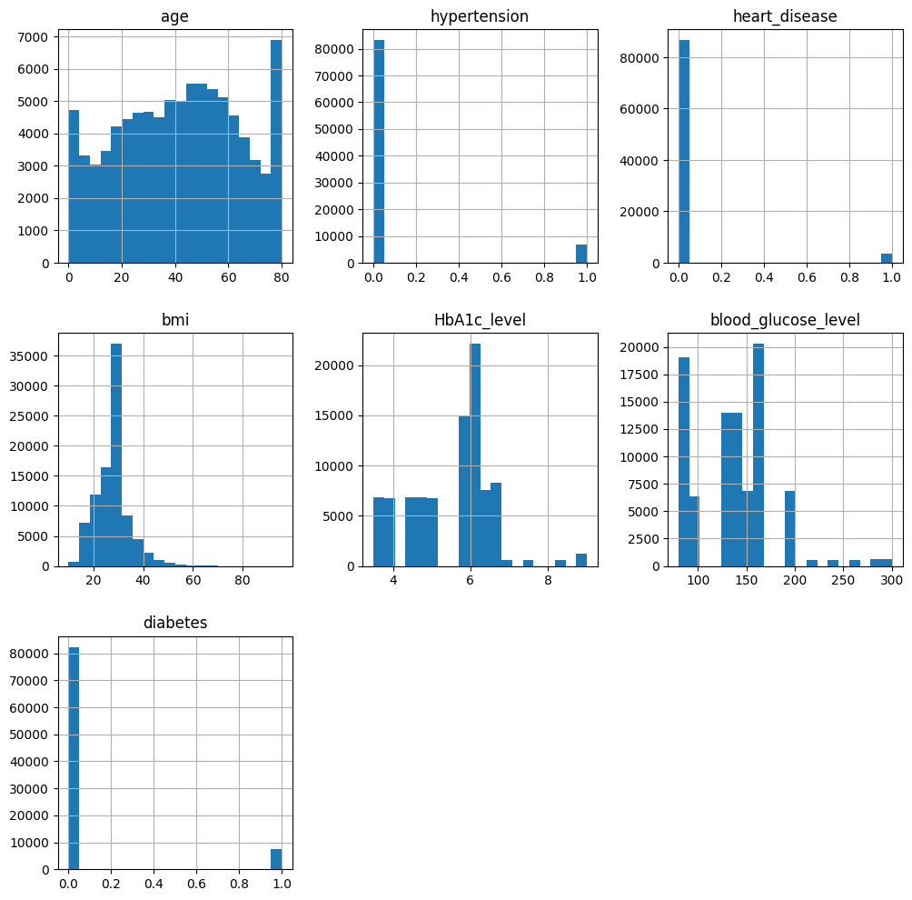
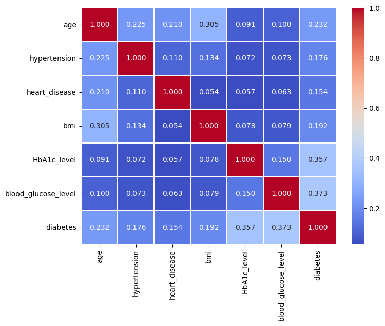
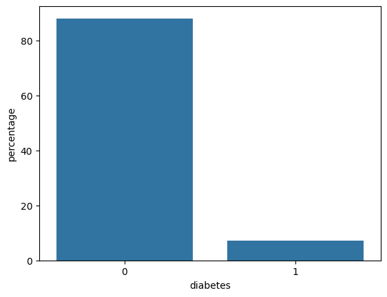
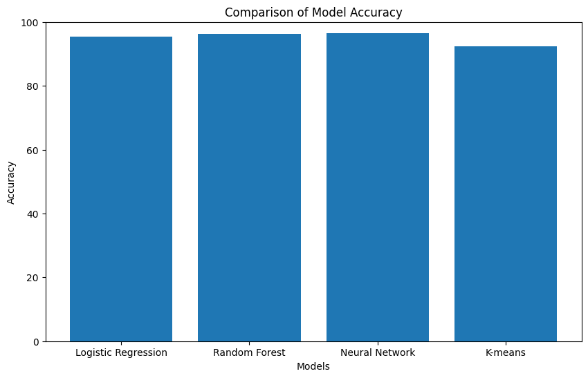
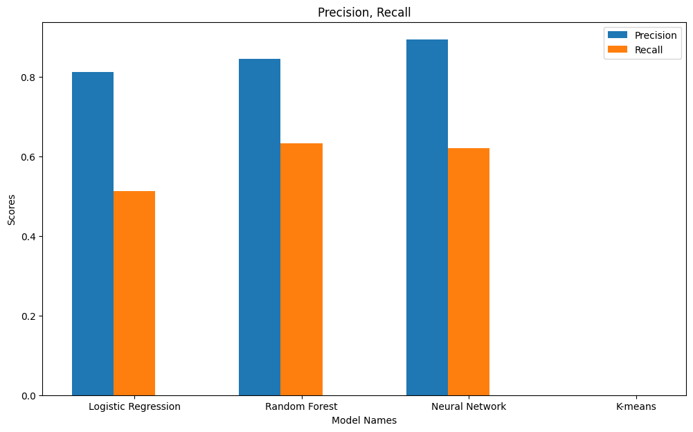
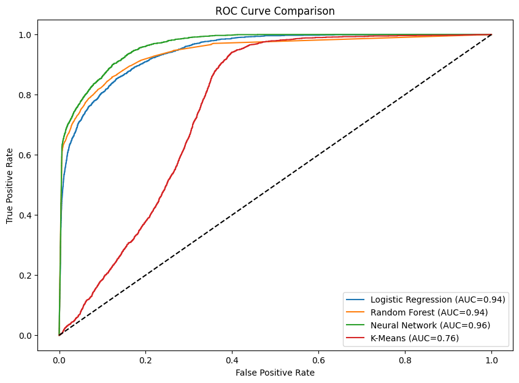
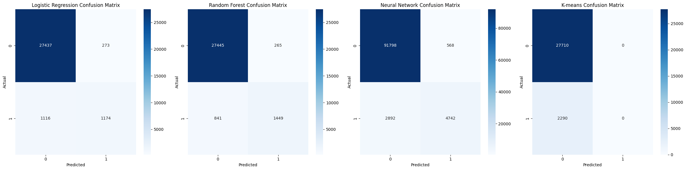

<a id="readme-top"></a>
# About The Project
This repository contains a machine learning pipeline for **binary diabetes prediction** using demographic, health, and lifestyle attributes. The project compares four different approaches—**Logistic Regression**, **Random Forest**, **Neural Network**, and **K-Means Clustering**—to identify individuals at risk of diabetes based on features such as age, BMI, HbA1c level, blood glucose level, smoking history, and more. This project was developed as part of the CSE422(Artificial Intelligence) course project at BRAC University.
<p align="right">(<a href="#readme-top">back to top</a>)</p>

# Built With
* 
* 
* 
* 
* 
* 
* 
* 
<p align="right">(<a href="#readme-top">back to top</a>)</p>

# Dataset Description

* **Source:** Loaded from [Google Drive](https://drive.google.com/file/d/1dtRKJuKtyhWD715R4pTALh5Fi5MIK9fg/view?usp=sharing) (100,001 patient records)
* **Target Column:** `diabetes` (binary: 0 = non-diabetic, 1 = diabetic)
* **Features (9 columns):**

  | Feature | Type |
  |:---|:---|
  | `gender` | Categorical |
  | `age` | Numerical |
  | `hypertension` | Numerical (binary) |
  | `heart_disease` | Numerical (binary) |
  | `smoking_history` | Categorical |
  | `bmi` | Numerical |
  | `HbA1c_level` | Numerical |
  | `blood_glucose_level` | Numerical |
  | `diabetes` | Target (binary) |

* **Class Distribution (Imbalanced):**

  | Class | Count | Percentage |
  |:---:|:---:|:---:|
  | 0 (Non-diabetic) | 92,366 | ~87.97% |
  | 1 (Diabetic) | 7,634 | ~7.27% |
<p align="right">(<a href="#readme-top">back to top</a>)</p>

# Preprocessing Pipeline

| Step | Details |
| :--- | :--- |
| **Missing Value Handling** | Empty strings → NaN; numerical nulls → median; categorical nulls → mode |
| **Correlation Analysis** | Heatmap generated via Seaborn; strong positive correlation between HbA1c_level, blood_glucose_level and diabetes |
| **Categorical Encoding** | OneHotEncoder (`drop='first'`) on `gender` and `smoking_history` |
| **Feature Scaling** | StandardScaler (Z-score normalization) on non-binary numerical features |
| **Train-Test Split** | 70% / 30%, `random_state=42`, stratified on target |
| **Class Imbalance Handling** | SMOTE applied on training set (balanced to 64,656 samples per class) |
<p align="right">(<a href="#readme-top">back to top</a>)</p>

# Models & Specifications

| Model | Key Parameters |
| :--- | :--- |
| **Logistic Regression** | `max_iter=100`, `random_state=42` |
| **Random Forest** | `n_estimators=100`, `random_state=42` |
| **Neural Network (Keras)** | Sequential: Dense(16, ReLU) → Dense(8, ReLU) → Dense(1, Sigmoid); Adam optimizer, binary crossentropy, 10 epochs, batch size 8, `validation_split=0.2` |
| **K-Means Clustering** | `n_clusters=2`, `random_state=42`; cluster-to-class mapping via mode |
<p align="right">(<a href="#readme-top">back to top</a>)</p>

# Model Performance & Comparison

| Model | Accuracy | Precision | Recall | AUC |
| :--- | :---: | :---: | :---: | :---: |
| **Logistic Regression** | 0.9537 | 0.8113 | 0.5127 | 0.9444 |
| **Random Forest** | 0.9631 | 0.8454 | 0.6328 | 0.9422 |
| **Neural Network** | 0.9654 | 0.8930 | 0.6212 | 0.9639 |
| **K-Means Clustering** | 0.9237 | 0.0000 | 0.0000 | 0.7635 |

> **Note:** K-Means predicted all samples as non-diabetic (class 0), resulting in zero precision and recall for the diabetic class.

### Evaluation Includes
* Accuracy bar chart comparison
* Confusion matrix heatmaps for all four models
* Precision & Recall grouped bar chart
* ROC curve comparison with AUC scores
<p align="right">(<a href="#readme-top">back to top</a>)</p>

# How to Run

1. **Clone the Repository**
   ```bash
   git clone https://github.com/YOUR-USERNAME/cse422.git
   cd cse422
   ```

2. **Install Dependencies**
   ```bash
   pip install pandas numpy matplotlib seaborn scikit-learn tensorflow imbalanced-learn jupyter
   ```

3. **Run Notebook**
   ```bash
   jupyter notebook 422_project.ipynb
   ```
   The dataset is automatically downloaded from Google Drive when the notebook runs.
<p align="right">(<a href="#readme-top">back to top</a>)</p>

# Contributors
* Sanjid Hasan Sourov (sanjid.hasan.sourov@g.bracu.ac.bd)
<p align="right">(<a href="#readme-top">back to top</a>)</p>


# Sample Visualizations







<p align="right">(<a href="#readme-top">back to top</a>)</p>
